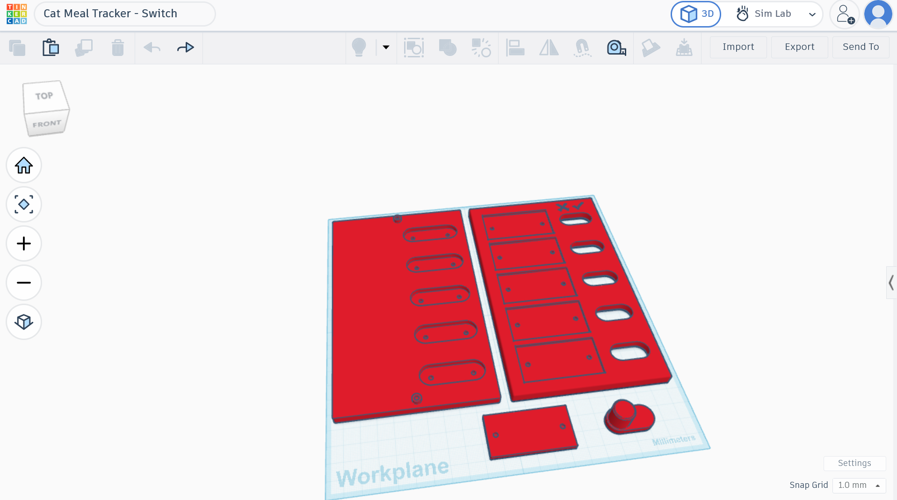
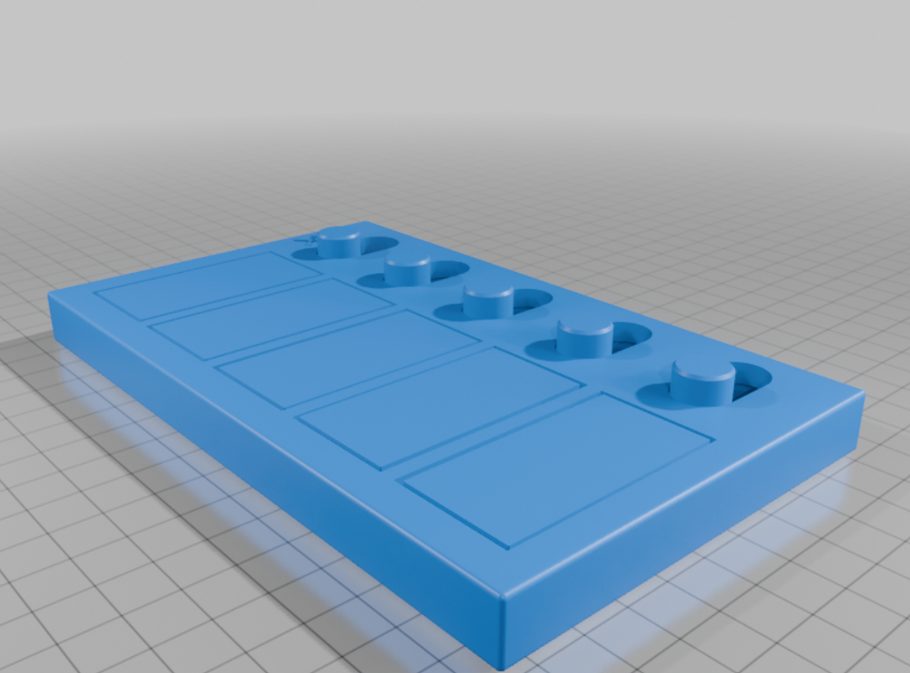

# Cat-Meal-Tracker
  This is a meal tracker for cats because they act like they didn't get fed even when they have been!

## Why I made this
In my experience, cats have a reputation of looking like they haven't been fed when they really have, so two people feed them for the same meal. This model fixes that, because they can just check the tracker.

## How I made it
I used Tinkercad to make this 3D model, and no problems arose!

## How to make the project
### To make this for yourself, you'll need:
-1 top piece\
-1 bottom piece\
-5 switch pieces\
-5 tile pieces\
-48 2x3mm magnets (you can find packs of 200 on amazon for like 10$)\
-Superglue (to glue the magnets in)\
-PLA filament\
-A 3D printer with a bed big enough to fix the files

### Print the parts with these settings:
-A nozzle size of 0.4 or smaller\
-Infill of 10% or higher\
-Support at 75 degrees

### Assembly
  1. Add magnets in all the holes, with a little dot of superglue at the bottom of each hole (make sure they're in the right direction!)\
  2. Write the time that your cat should be fed at on the tiles and they should snap into place on the suitable holes in the top piece\
  3. Assemble the rest of the pieces! They should snap together and be pretty intuitive where they go.\
  4. Attach it to any magnetic surface of your choice!
  
    

## AI DISCLOSURE
NO AI was used to make this, it was made by hand in Tinkercad.
